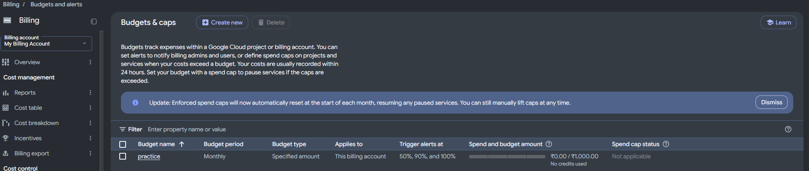
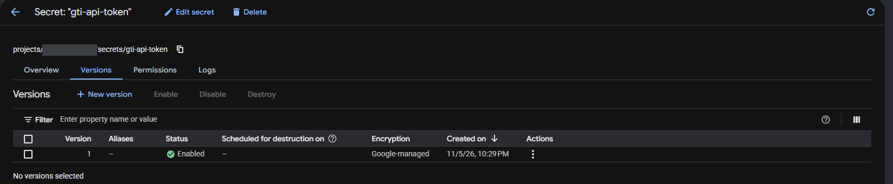
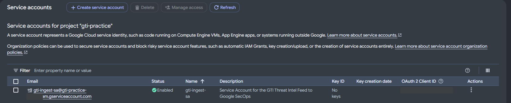
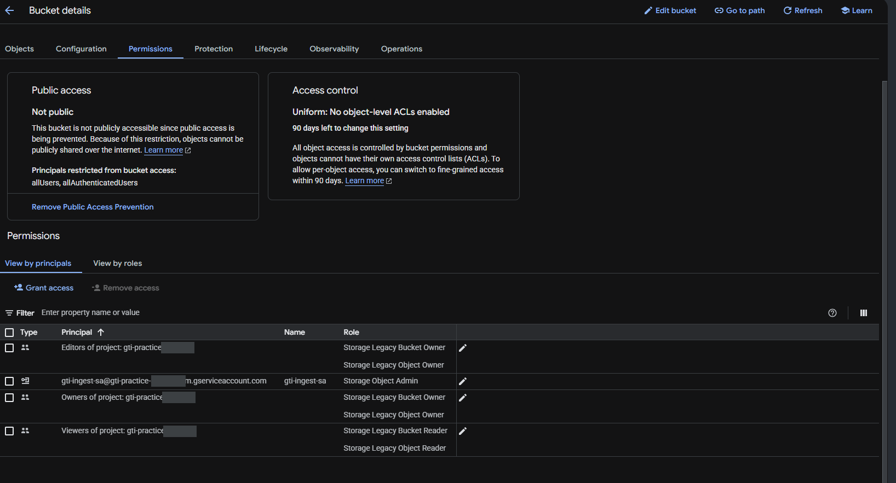
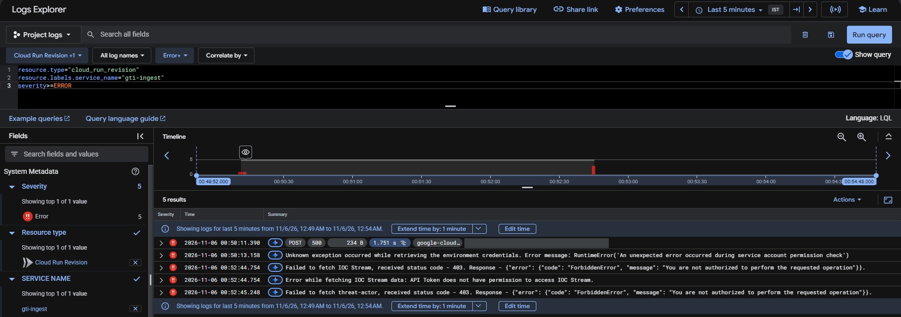
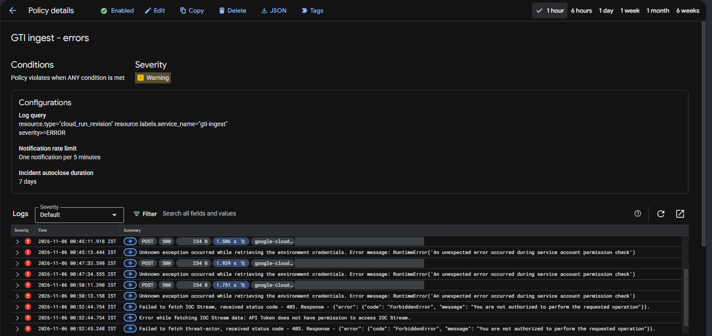
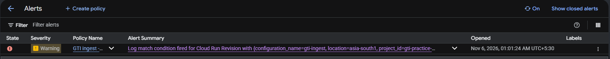
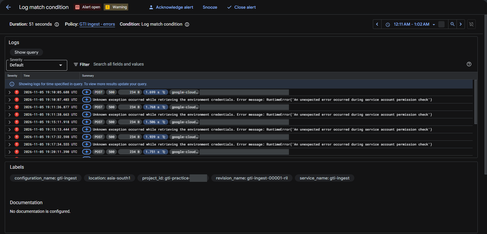

The request sounded simple. A team pays for Google Threat Intelligence (GTI), the platform that brings together Mandiant's research, VirusTotal and Google's own telemetry. Inside GTI they can follow the threat groups that matter to them, and GTI keeps a list of every known indicator tied to those groups: file hashes, IP addresses, domains, URLs.

The problem was that those indicators stayed inside GTI. They weren't reaching Google SecOps, the SIEM where the alerting actually happens. So the team was paying for very specific intelligence about the people most likely to attack them, and the SIEM couldn't act on any of it.

Think of it like a building that subscribes to a list of known burglars, but nobody ever gives that list to the security guard at the door.

## "Doesn't SecOps already have Mandiant intel?"

That was my first question too. Depending on the package, SecOps does come with Google's built-in threat intelligence. It's useful, but it's Google's general picture of what's bad on the internet. It isn't the curated list of groups *you* chose to track, and in what I looked at, the threat actor details showed up as links back to VirusTotal rather than as names a rule could match on. You can't write "alert me when anything tied to group X shows up" if group X's name isn't in the data.

So the real question was how to get a team's own GTI data into SecOps, on a schedule, without someone copying lists around by hand.

## Google already built the pipe

It turns out Google documents this exact path. They call it the [bring-your-own-license GTI integration](https://docs.cloud.google.com/chronicle/docs/detection/gti-byol), and the code lives in Google's public [ingestion-scripts repository](https://github.com/chronicle/ingestion-scripts/tree/main/google_threat_intelligence). The moving parts are all standard Google Cloud services:

- **Cloud Scheduler** is the alarm clock. Once an hour, it wakes the function up.
- **Cloud Run function** is the worker. It asks the GTI API for new threat lists and indicator streams.
- **Secret Manager** is the locked drawer for the GTI API key, so the key never sits in code or settings.
- **A Cloud Storage bucket** is the worker's notebook. It saves where it stopped, so the next run picks up from there instead of pulling everything again.
- **The Chronicle API** is the delivery door. Indicators go straight into SecOps under the `GCP_THREATINTEL` log type, and Google's own parser turns them into searchable entities.

One line in Google's README is worth noticing: even teams on the top SecOps package still get value from this script, because it can ingest data from their GTI threat profile. That's exactly the "groups we chose to track" data from the request.

Using Google's script instead of writing my own was an easy call. It's maintained by Google, it already handles paging and checkpoints, and it gives the team one less piece of custom code to look after. It also matches what was asked for: set it up once, then forget about it.

## Practising before touching anything real

I don't have a spare SecOps tenant to experiment on, so I did the next best thing. I made a fresh Google Cloud project on a free trial and deployed the real script there. Two parts were never going to work: there's no SecOps tenant behind it, and a free VirusTotal key isn't allowed to pull GTI threat lists. But everything *before* those two points is the same as a real deployment, and that's where most of the surprises turned out to be.

First, before creating anything at all, a budget alert. The README's example gives the function 8 GB of memory and runs it every hour. A mistake like that in a personal project quietly turns into a bill.


*A monthly budget with email alerts at 50%, 90% and 100%. Boring, and the first thing I do in any new project.*

Then the API key went into Secret Manager. The function is only ever given the *path* to the secret, never the key itself.


*The key lives in Secret Manager. The function only knows where to find it.*

Next came a private bucket for the checkpoints, and a dedicated service account for the function to run as. "No keys" in that list is what you want to see: no downloadable key file exists for this account, so there's nothing to leak.


*One identity for one job, and no key files to lose.*


*Public access blocked, and the service account given access to this one bucket only. That last part didn't survive, as you'll see.*

Packaging the script is five lines in Cloud Shell. Google's README asks for the shared `common` folder to sit inside the zip, which is easy to miss:

```bash
git clone https://github.com/chronicle/ingestion-scripts.git
cd ingestion-scripts/google_threat_intelligence
cp -r ../common .
zip -r ~/gti.zip .
gcloud storage cp ~/gti.zip gs://BUCKET_NAME/
```

Then the deploy:

```bash
gcloud functions deploy gti-ingest --gen2 --runtime=python312 \
  --region=REGION --source=gs://BUCKET_NAME/gti.zip --entry-point=main \
  --service-account=SA_NAME@PROJECT_ID.iam.gserviceaccount.com \
  --trigger-http --no-allow-unauthenticated --timeout=3600s \
  --set-env-vars="CHRONICLE_CUSTOMER_ID=SECOPS_CUSTOMER_ID,CHRONICLE_PROJECT_NUMBER=PROJECT_NUMBER,CHRONICLE_REGION=SECOPS_REGION,GCP_BUCKET_NAME=BUCKET_NAME,GTI_API_TOKEN=projects/PROJECT_NUMBER/secrets/SECRET_NAME,FETCH_IOC_STREAM_ENABLED=true,THREAT_LISTS=threat-actor"
```

`--no-allow-unauthenticated` means nobody on the internet can trigger the function. Only identities you've allowed can.

## The five walls

**Wall 1: the build was refused.** The very first deploy failed because a *different* service account, the one Google uses to build the function, was missing the Cloud Build Builder role. Newer projects don't always grant it automatically. gcloud warns you right before deploying and even prints the fix. I pressed "yes, continue" anyway and learned that lesson properly.

**Wall 2: an API that isn't in the README.** The function deployed, then failed on its first run with a plain 500. The logs explained it: the Cloud Resource Manager API wasn't enabled. Google's README has a table of APIs to enable, and this one isn't in it.

**Wall 3: the script checks its own permissions.** Before doing any work, the script reads the project's permission list to make sure it has what it needs. Reading that list needs its own permission, `resourcemanager.projects.getIamPolicy`. The narrowest built-in role that includes it is **Browser**, which can only look, never change anything.

**Wall 4: "not enough permissions", without saying which.** The check now ran, and failed with a message that didn't name the missing roles. Instead of guessing, I searched the code for them:

```bash
grep -rn "roles/" . --include=*.py | grep -v _test
```

Three roles, hardcoded: Storage Admin, Secret Manager Secret Accessor and Cloud Scheduler Job Runner, all at **project** level. My service account only had storage access on its one bucket, so the check couldn't see it.

**Wall 5: the clever fix that didn't work.** Project-wide Storage Admin means the function could read or delete *every* bucket in the project, which is far more than it needs. So I tried the textbook least-privilege move: grant Storage Admin with an IAM condition that limits it to this one bucket. The check still failed.

The reason took one more look at the code. It asks for the permission list without requesting policy version 3, and Google's [IAM documentation](https://docs.cloud.google.com/iam/docs/allow-policies) says that in that case, a role with a condition comes back renamed, something like `roles/storage.admin_withcond_<hash>`. The script looks for the exact name `roles/storage.admin`, doesn't find it, and gives up.

The clean way around this, without changing Google's code, is to give the pipeline **its own GCP project**. Then "project-wide" only covers this one job's bucket, and least privilege comes from the project boundary instead of from conditions.

## It works, and it fails quietly

With plain Storage Admin in place, the next run got all the way through:

```text
Service account has sufficient permissions.
Google Threat Intelligence Client Initialized.
Enabled methods: get_and_ingest_ioc_stream_events, get_and_ingest_threat_list_events
Failed to fetch IOC Stream, received status code - 403.
Failed to fetch threat-actor, received status code - 403.
Methods execution completed.
```

The two 403s were expected: a free key isn't allowed to pull GTI threat lists or IoC streams. With a real GTI licence, this is exactly where indicators would start flowing.

The interesting part is the last line. Both fetches failed, and the function still answered **"data ingestion completed"** with a success status. Put it on an hourly schedule and the scheduler shows green every hour while zero indicators arrive. That's the worst kind of failure for a security pipeline: one nobody notices.

So the last piece wasn't the schedule. It was an alert. In Logs Explorer, this query catches every error the function writes, including the quiet 403s and the loud crashes from earlier:

```text
resource.type="cloud_run_revision"
resource.labels.service_name="gti-ingest"
severity>=ERROR
```


*Every failure from the night in one query: earlier crashes, then the 403s from the run that reported "completed".*

From there, **Actions → Create log alert** turns the query into an alerting policy that emails someone, with a five-minute limit so a bad hour doesn't become a hundred emails.


*The alert policy built on that query.*

An alert you've never seen fire is an assumption, not a control. So I ran the function one more time. It said "data ingestion completed" again, exactly as before, and a moment later Cloud Monitoring opened an incident against the policy.


*The "successful" run, caught.*


*Inside the incident: every error the function logged, so whoever gets paged can see what went wrong without digging.*

Now the success message can say whatever it likes. If nothing arrives, someone hears about it.

## What I'd tell the next person

- **Give it its own GCP project.** The script's permission check doesn't accept bucket-scoped or conditional roles, so the project boundary is your least-privilege control.
- **Enable Cloud Resource Manager** and grant **Browser**. Neither is in the README, and the script stops without both.
- **Read the code when an error is vague.** One `grep` told me more than an hour of guessing would have.
- **Point the secret at the secret, not a version.** The script uses the latest version if you leave `/versions/N` off the path, so rotating the key later needs no redeploy.
- **Don't trust a green run.** Alert on the function's errors, because its success message isn't proof that anything arrived.
- **Check the first real data before writing rules.** Once indicators land under `GCP_THREATINTEL`, open a few and confirm the threat group names are actually filled in before building any "alert on group X" detection on top. I couldn't test that part without a paid key, so it stays on the checklist.

The pipe itself was never the hard part. Google wrote it. The real work was everything around it: the permissions it quietly expects, the API nobody mentions, and the success message that isn't one. That's usually where security engineering lives.
